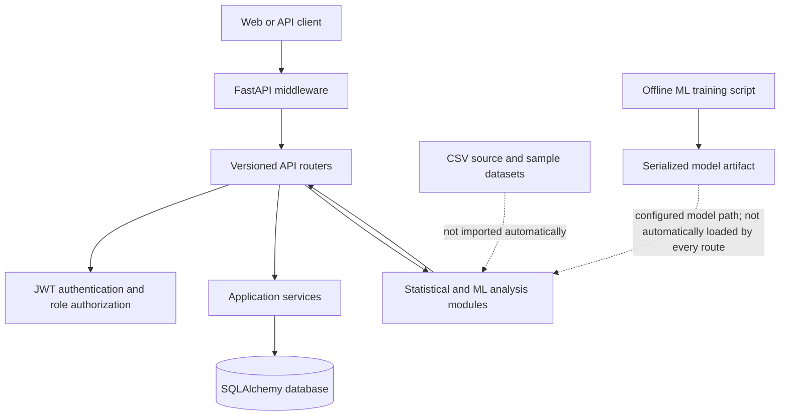

# System Architecture

## Overview

The project is a Python/FastAPI health-surveillance service. It accepts
authenticated health reports, stores application records through SQLAlchemy,
and exposes analysis operations for symptom screening, case trends, outbreak
signals, risk assessment, and regional hotspots. API responses are screening
or reporting outputs; they are not medical diagnoses or confirmation of an
outbreak.



## Request flow

1. A request enters the FastAPI application in `backend/app/main.py`.
2. Trusted-host, CORS, request-size, request logging, and response-security
   middleware run around the request.
3. Versioned routers are mounted under the configured `API_V1_PREFIX`
   (default `/api/v1`).
4. Protected routes validate a bearer JWT and, where required, verify the
   user's role and active/verified official record.
5. Route handlers validate input with Pydantic, then call a service, database
   query, or analysis function.
6. Responses use JSON. HTTP and validation errors are returned in the
   application's standard error envelope.

## Main components

| Component | Location | Responsibility |
|---|---|---|
| Application entry point | `backend/app/main.py` | FastAPI construction, middleware, error handlers, health endpoints, and router registration |
| Configuration | `backend/app/config.py` | Environment-backed application, security, CORS, host, database, and AI settings |
| API routes | `backend/app/api/` | Authentication, user, report, admin, alert, dashboard, and AI endpoints |
| Authentication and authorization | `backend/app/security/` | JWT user lookup and role/official-record checks |
| SQLAlchemy models | `backend/app/models/` | Users, reports, alerts, audit events, diseases, locations, and administrator records |
| Database session | `backend/app/database/database.py` | SQLAlchemy engine, session factory, and request-scoped database dependency |
| Application services | `backend/app/services/` | Reusable report, user, notification, and disease operations |
| Analysis modules | `backend/app/ai/` | Symptom analysis, trend forecasting, outbreak detection, hotspot detection, risk, and recommendations |
| Offline ML scripts | `backend/ml/` | Model training, evaluation, and prediction utilities |
| Data files | `data/raw/`, `data/processed/`, `data/sample/` | CSV source, transformed, and sample datasets; files are not automatically imported into the database |
| SQL reference | `database/` | PostgreSQL schema and demonstration seed SQL |

## Logging

The application uses rotating JSON-lines logs under the configured log
directory (default `logs/`). Each file is capped at 5 MB with five backups:

| File | Contents |
|---|---|
| `app.log` | Application lifecycle, application events, and application-module logs |
| `error.log` | Application errors and above |
| `access.log` | HTTP method, path, status, duration, and request ID; no request body |
| `security.log` | Account registration and login outcomes without passwords or tokens |
| `ai_prediction.log` | AI operation and result type; no symptoms or patient inputs |

Sensitive fields such as passwords, tokens, email addresses, and symptoms are
redacted by the structured formatter. Set `LOG_DIRECTORY` to change the output
directory and `LOG_LEVEL` to change the application logging threshold.

## Persistence and data

- API records are persisted through SQLAlchemy models and the configured
  database session.
- `backend/app/database/database.py` currently creates a SQLite engine using a
  hard-coded `DATABASE_URL`. Although `DATABASE_URL` is defined in
  `backend/app/config.py`, that setting is not currently used by this engine.
- `database/schema.sql` is a PostgreSQL-oriented schema reference; it is not
  automatically applied by application startup.
- `backend/app/database/seed.py` creates mapped tables and seeds reference
  diseases and demonstration locations when run explicitly.
- CSV files under `data/` are standalone datasets. The application does not
  currently load those files into its database at startup.

## Security boundaries

- Registration creates ordinary user accounts; it does not grant official or
  administrator privileges.
- Protected requests use `Authorization: Bearer <token>`.
- Health-official and administrator authorization depends on active,
  verified official records as implemented by the authorization dependencies.
- Health reports and surveillance counts are user-submitted or aggregate
  reporting data; a report or model output is not a clinically confirmed case.
- Request size, CORS, trusted hosts, security response headers, and
  non-sensitive validation errors are handled in the application layer.
- Rate-limit settings exist in configuration, but this application entry
  point does not currently install rate-limiting middleware.
- Production deployments must provide strong secrets, restrict allowed
  origins/hosts, use HTTPS, and apply database migrations and backups using
  the deployment's operational process.

## Running locally

From the project root, with the project virtual environment installed:

```powershell
.\.venv\Scripts\python.exe -m uvicorn app.main:app --app-dir backend --reload
```

The default API prefix is `/api/v1`. In non-production environments, FastAPI
serves the interactive API reference at `/docs` and the OpenAPI schema at
`/openapi.json`.
